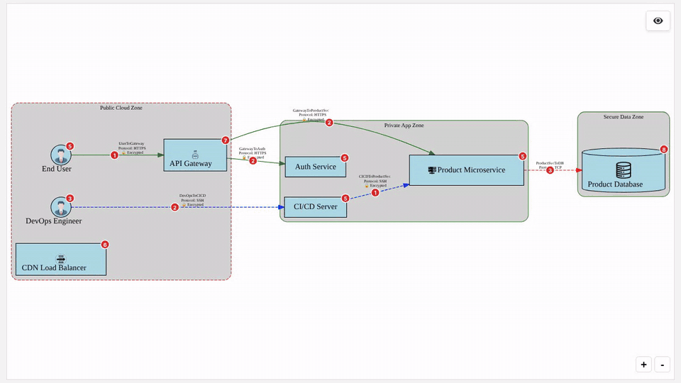
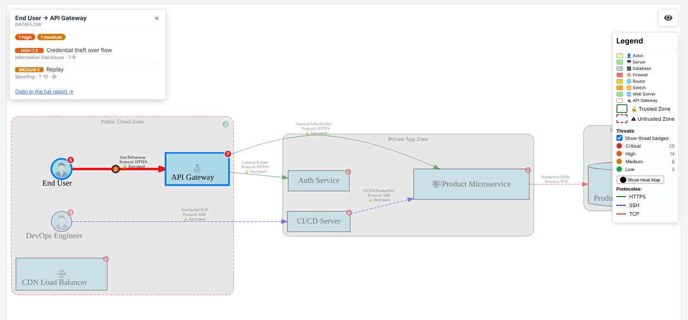
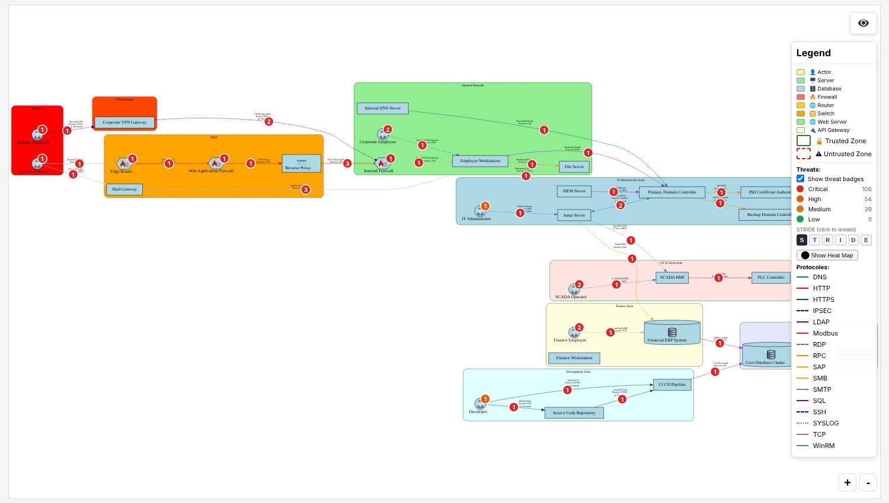

<p align="center">
  
</p>

<h1 align="center">SecOpsTM</h1>

<p align="center">
  <b>Threat modeling as code.</b> One Markdown file in, a STRIDE + MITRE ATT&amp;CK threat report out.<br>
  Interactive diagrams, CAPEC / D3FEND / CVE mapping, attack paths, SARIF and STIX, ready for CI.
</p>

<p align="center">
  <a href="https://ellipse2v.github.io/SecOpsTM/"><b>Live demo</b></a> ·
  <a href="https://github.com/ellipse2v/SecOpsTM#quick-start">Quick start</a> ·
  <a href="https://github.com/ellipse2v/SecOpsTM/blob/main/docs/index.md">Docs</a> ·
  <a href="https://owasp.org/www-project-secopstm/">OWASP project page</a>
</p>

<p align="center">
  <a href="https://owasp.org/www-project-secopstm/"></a>
  <a href="https://pypi.org/project/SecOpsTM/"></a>
  <a href="https://hub.docker.com/r/ellipse2v/secopstm"></a>
  <a href="https://github.com/ellipse2v/SecOpsTM/actions/workflows/coverage_check.yml"></a>
  <a href="https://www.python.org/downloads/"></a>
  <a href="https://github.com/ellipse2v/SecOpsTM/blob/main/LICENSE"></a>
</p>

<p align="center">
  <a href="https://ellipse2v.github.io/SecOpsTM/">
    
  </a>
  <br>
  <sub>The generated HTML diagram: click a badge to list its threats, isolate a STRIDE category, show the heat map. <a href="https://ellipse2v.github.io/SecOpsTM/">Try it live.</a></sub>
</p>

## See it in 30 seconds

```bash
pip install SecOpsTM
secopstm demo                          # analyses a bundled example and opens its diagram
secopstm --model-file threat_model.md  # then your own model
```

No API key, no server: the demo runs the rule engine only. Prefer a browser? The
[live demo](https://ellipse2v.github.io/SecOpsTM/) shows the same reports, including
AI-enriched ones.

<table>
  <tr>
    <td width="50%"></td>
    <td width="50%"></td>
  </tr>
  <tr>
    <td align="center"><sub>Every component and dataflow carries its threats, scored and mapped to ATT&amp;CK.</sub></td>
    <td align="center"><sub>Scales to real networks: isolate one STRIDE category across 40+ elements.</sub></td>
  </tr>
</table>

A model is plain Markdown that lives next to your code:

```markdown
## Boundaries
- **Internet**: isTrusted=False
- **DMZ**: isTrusted=True

## Actors
- **User**: boundary=Internet

## Servers
- **WebApp**: boundary=DMZ, type="web_server"

## Data
- **Credentials**: classification="SECRET"

## Dataflows
- **Login**: from="User", to="WebApp", protocol="HTTPS", data="Credentials"
```

See [the DSL reference](docs/defining_threat_models.md) and the
[ready-to-use templates](docs/examples.md).

---

## Quick start

### Option A — Docker (no Python setup required)

```bash
docker run -p 127.0.0.1:5000:5000 \
  -v $(pwd)/output:/app/output \
  ellipse2v/secopstm:latest
```

Open <http://localhost:5000>. Reports land in `$(pwd)/output/<timestamp>/`.

> **Security note:** the server is a single-user tool with no authentication by
> default. `-p 127.0.0.1:5000:5000` keeps it reachable only from this machine.
> Token auth and multi-user workspaces are covered in
> [docs/usage.md § Server configuration](docs/usage.md#server-configuration).

#### With AI enrichment (LLM + RAG)

**Default provider: NVIDIA NIM** (Llama 3.3 70B) — free API key at https://build.nvidia.com/meta/llama-3_3-70b-instruct

```bash
# Step 1 — Download RAG vector store (one-time, ~200 MB)
docker run --rm -v secopstm-rag:/app/rag ellipse2v/secopstm:latest --init-rag

# Step 2 — Run
docker run -p 127.0.0.1:5000:5000 \
  -e NVIDIA_NIM_API_KEY=your_key \
  -v secopstm-rag:/app/rag \
  -v $(pwd)/output:/app/output \
  ellipse2v/secopstm:latest
```

Other supported providers: `GEMINI_API_KEY`, `OPENAI_API_KEY`, `MISTRAL_API_KEY`, `GROQ_API_KEY`, `XAI_API_KEY`. Ollama works fully offline (no key needed).

### Option B — PyPI

```bash
pip install SecOpsTM
secopstm demo     # check the install: analyses a bundled example and opens its diagram
```

Install Graphviz for diagram generation:
- Windows: <https://graphviz.org/download/>
- macOS: `brew install graphviz`
- Linux: `sudo apt-get install graphviz`

### Option C — From source

1.  **Clone the repository:**
    ```bash
    git clone https://github.com/ellipse2v/SecOpsTM.git
    cd SecOpsTM
    ```

2.  **Install Python dependencies:**
    ```bash
    pip install -e .
    ```
    After this step the `secopstm` command is available in your environment.

3.  **Install Graphviz** (see Option B above).

After installation, restart your terminal or IDE.

### Basic CLI usage

```bash
# Try it: analyse a bundled example (rule engine only, no API key) and open its diagram
secopstm demo                # or: secopstm demo on-prem   (40+ elements)

# Full analysis — HTML + JSON + SVG in output/
secopstm --model-file threatModel_Template/threat_model.md

# Rule engine only, even if config/ai_config.yaml enables an LLM provider
secopstm --model-file model.md --no-ai

# JSON only, printed to stdout — ideal for CI pipelines
secopstm --model-file model.md --stdout

# JSON to a specific file
secopstm --model-file model.md --output-format json --output-file report.json

# Launch the web editor
secopstm --server
```

### In CI: the GitHub Action

Threat-model every pull request: the action analyses your model, posts a summary comment on the PR, uploads the reports as an artifact and fails the job when threats at or above `gate` are found.

```yaml
# .github/workflows/threat-model.yml
name: Threat model
on: pull_request
permissions:
  contents: read
  pull-requests: write      # PR comment
jobs:
  secopstm:
    runs-on: ubuntu-latest
    steps:
      - uses: actions/checkout@v4
      - uses: ellipse2v/SecOpsTM@main
        with:
          model-file: threat_model.md
          gate: HIGH                       # CRITICAL | HIGH | MEDIUM | LOW | none
          # baseline: threat_baseline.json # only NEW threats fail the gate
          # sarif: 'true'                  # Security > Code scanning (needs security-events: write)
```

Other inputs: `terraform-path` / `ansible-path` (analyse IaC instead of a model), `navigator`, `attack-flow`, `accepted-risks`, `ai-config-file`. Outputs: `output-dir`, `report-json`, `report-html`, `total-threats`, `critical-threats`... See [`action.yml`](action.yml) for the full list. Without `ai-config-file` the action uses the rule engine only: no API key, nothing leaves the runner.

---

## Why SecOpsTM

SecOpsTM is an [OWASP project](https://owasp.org/www-project-secopstm/) built on
[pytm](https://github.com/OWASP/pytm). It sits between "code-only" tools and
"drawing" tools: the model is a text file you review in a pull request, and the output
is an interactive report someone outside the security team can actually read.

An honest comparison with the open-source tools you are most likely to consider:

| | **SecOpsTM** | **pytm** | **Threat Dragon** | **Threagile** |
|---|---|---|---|---|
| Model written as | Markdown DSL (or web editor) | Python code | Diagram drawn in a GUI (stored as JSON) | YAML |
| Methodology | STRIDE | STRIDE-style threat library | STRIDE, LINDDUN, CIA, DIE, PLOT4ai | Built-in risk rules |
| Threats found by | Rule engine + optional LLM / RAG | Rule engine (threat library) | Per-element suggestions, then manual editing | Rule engine |
| ATT&CK / CAPEC / D3FEND / CVE mapping | All four, per threat | CAPEC / CWE references | Not built in | CWE references |
| Attack paths across dataflows | Yes | No | No | No |
| Output | Interactive HTML diagram + report, JSON, SARIF, STIX, ATT&CK Navigator | DFD, sequence diagram, templated report | In-app diagram, PDF report | PDF report, Excel, diagrams, JSON |
| CI gate | GitHub Action with PR comment and baseline | Scriptable CLI | Not designed for it | CLI / Docker |
| Generate the model from IaC | Terraform, Ansible, Docker Compose | No | No | No |
| Maturity and community | Young project, small community | Mature, OWASP | Mature, OWASP Flagship, largest community | Established |

**Pick another tool if:**
- you need LINDDUN or privacy threat modeling: Threat Dragon covers it, SecOpsTM is STRIDE only;
- your team wants to draw diagrams rather than write text: Threat Dragon's editor is far more
  polished than SecOpsTM's graphical editor, which is still under development;
- you want a minimal library to script yourself in Python: pytm is lighter and SecOpsTM depends on it anyway.

**Pick SecOpsTM if** you want threat models reviewed like code, threats that come with
ATT&CK techniques and countermeasures rather than a generic list, a gate in CI, and a
report your developers will open. AI is optional: everything above works offline with the
rule engine, and AI-generated threats are labelled as such so you can review them.

---

## Features

**Analysis**
- STRIDE threats for every component, dataflow and trust boundary, mapped to
  MITRE ATT&CK, CAPEC, D3FEND and CVE.
- Context-aware severity: base scores, target multipliers, protocol, network exposure,
  CVE / CWE signals and implemented D3FEND mitigations. [Customizable](docs/customizing_scoring.md).
- Attack chains: multi-step paths that chain threats across dataflows, plus
  [Goal-Driven Attack Flows](docs/gdaf.md) towards the assets you care about.
- VEX support: fixed CVEs lower the severity without manual edits.

**AI (optional)**
- Hybrid mode: pytm rules, a per-component LLM pass and a cross-model RAG pipeline
  (local ChromaDB), deduplicated into one list.
- Any LiteLLM provider: NVIDIA NIM, Gemini, OpenAI, Mistral, Groq, xAI, or Ollama fully
  offline. Configured in `config/ai_config.yaml`.
- SOC detection rules, CISO briefing, attack path narratives and an opt-in Red/Blue
  debate. [What each AI pass does](docs/ai_roles.md) and
  [how the debate was evaluated](docs/evaluation.md).

**Outputs**
- Self-contained interactive HTML diagram: threat badges, STRIDE and severity filters,
  heat map, protocol filter, sub-model drill-down.
- HTML and versioned JSON reports, SARIF, STIX 2.1, ATT&CK Navigator layers, Attack Flow
  diagrams, report diff.

**Workflow**
- `secopstm` CLI and a [GitHub Action](action.yml) for CI.
- Web editor with live diagram, validation and autocomplete; project mode for
  hierarchical models (`secopstm --server --project path/`).
- Models generated from Terraform, Ansible or Docker Compose.
- Extensible threats, mappings and prompts ([extensibility](docs/extensibility.md)).

The complete list is in [docs/features.md](docs/features.md).

---

## Documentation

Everything else (CLI flags, server configuration, DSL reference, AI configuration,
architecture) is in [docs/](docs/index.md). The plan ahead is in the [roadmap](docs/Roadmap.md).
Contributions are welcome: see [CONTRIBUTING.md](CONTRIBUTING.md).

## License

Apache License 2.0. See [LICENSE](LICENSE).

## Author

ellipse2v
